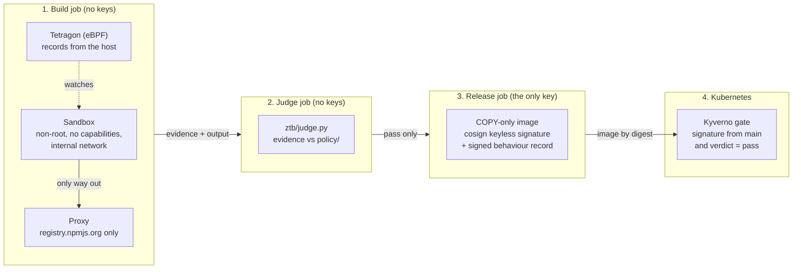

# Zero Trust Build Pipeline

A CI/CD pipeline that records what a software build really does, judges that record against written rules, signs it, and makes Kubernetes refuse any image without a signed, passing record.

## The problem

In May 2026, attackers published malicious versions of 42 TanStack npm packages. The packages still carried valid build provenance, because the malicious code ran inside the project's real release workflow. A signature shows where software was built. It doesn't show what happened during the build.

This project adds that missing evidence, then enforces it at deployment.

## The demo in 2 minutes

Each step links to a real run on GitHub's machines.

1. **A clean build passes and gets signed.** In this [pipeline run on `main`](https://github.com/anshumaan12-2003/zero-trust-build/actions/runs/42841714317), the build runs in a locked sandbox while eBPF records it. A separate job judges the recording, and only then does a third job sign and publish the image.
2. **A poisoned dependency is caught.** In the [attack lab](https://github.com/anshumaan12-2003/zero-trust-build/actions/runs/42783381402), a fake dependency's install script tries to connect to an outside address. The judge fails the build with NET-1, so no image is released ([results](docs/week9-attack-lab-results.md)).
3. **Kubernetes refuses what didn't pass.** In the [gate test](https://github.com/anshumaan12-2003/zero-trust-build/actions/runs/42765619166), the signed image runs. An unsigned image is refused, and so is one signed from any other branch. Someone with registry access can push an image but can't get it past the gate.
4. **It holds through GitOps.** In the [cluster test](https://github.com/anshumaan12-2003/zero-trust-build/actions/runs/42837282910), an unsigned image committed to Git is refused at the Deployment, so Argo CD can't deploy it. An alert fires when the gate is switched off.

## How it works

The main rule: **code that might be poisoned never gets a key, and code that holds a key never runs poisoned code.**



| Stage | What it does | Can it sign? |
|---|---|---|
| Sandbox | Runs the untrusted build as uid 1000 with every capability dropped. Its only way out is a proxy that allows just `registry.npmjs.org` | No |
| Record | Tetragon v1.8.0 records programs, connection attempts, sensitive file reads and memory reads from the kernel. Secret canaries prove it ran from start to end | No |
| Judge | A clean job compares the record against [`policy/build-policy.toml`](policy/build-policy.toml). It fails on any unexpected connection, decoy read, memory read, unknown program or lost event | No |
| Seal | Only after a pass, a third job builds the image with `COPY` only, signs it keylessly with cosign, and attaches the record as an in-toto attestation | **Yes, only here** |
| Gate | Kyverno admits the app image only if it has a signature and a passing record from `pipeline.yml` on `main`. It checks by digest | No, it only verifies |

Why these choices: [why Tetragon](docs/decisions/001-why-tetragon.md), [why three jobs](docs/decisions/002-why-three-jobs.md), and the [threat model](docs/threat-model.md).

## Results

Measured on GitHub's `ubuntu-24.04` runners. These are small samples, so they're given as counts.

| Measure | Result | Source |
|---|---|---|
| False alarms | **0 of 40** clean builds failed | [Week 10](docs/week10-measure-results.md) |
| Lost sensor events | **0 of 40** runs | [Week 10](docs/week10-measure-results.md) |
| Build attacks caught | **6 of 12**, plus all 3 evidence-tampering attempts | [Attack lab](docs/week9-attack-lab-results.md) |
| Gate cases | **8 of 8** behaved as designed, including one known gap | [Week 8](docs/week8-gate-results.md) |
| Added build time | **+18 s** (3.0 s plain, 21.0 s secured; median of 10 each) | [Week 10](docs/week10-measure-results.md) |
| Evidence per build | **6.5 MB** | [Week 10](docs/week10-measure-results.md) |
| Gate time per pod | **+1.1 s** (2.2 s on the first call) | [Week 10](docs/week10-measure-results.md) |
| Gate-down alert | Fires **120 to 141 s** after Kyverno is scaled to 0 | [Week 11](docs/week11-cluster-results.md) |

The 18 s is a fixed cost, so on this 3-second demo build it looks bigger than it would on a real one. Raw data is in [`results/`](results/).

## What it can't do

Each of these was tested, not guessed. Every one is a scenario the pipeline lets through, and each was predicted before the run.

- **Reading `/proc/<pid>/mem`.** The kernel refuses the open before the read hook fires, so there's no event to judge.
- **Data hidden in DNS lookups.** Lookups go to Docker's resolver, which the judge doesn't see.
- **Data sent through the allowed npm domain.** The proxy controls where traffic goes, not what it carries.
- **An extra file slipped into the output.** The record covers behaviour, not the output's contents.
- **Code that waits until the app runs.** Only the build is watched.
- **Scaling Kyverno to 0 opens the gate.** Kyverno removes its own webhooks. In Week 11, Argo CD's retry got an unsigned app running this way, and it kept running after Kyverno came back. An alert fires, but nothing prevents it yet.

It also trusts GitHub, Sigstore, the registry, and the source code on `main`. The [threat model](docs/threat-model.md) lists what would close each gap.

## How to run it

Everything heavy runs on GitHub's free Linux machines. Tetragon needs a Linux kernel, so it can't run in Docker Desktop on a Mac.

1. **Fork the repo**, then replace `anshumaan12-2003` with your GitHub name everywhere. Run `git grep -l anshumaan12-2003` to list the files, which include the gate policy, the workflows and the Argo CD files.
2. **Push to `main`.** [`pipeline.yml`](.github/workflows/pipeline.yml) builds, records, judges, signs and publishes to your GitHub container registry.
3. **Put the signed image's digest** into `gate/good-image.txt` and `deploy/app.yaml`.
4. **Open a pull request** to run the checks:

| Workflow | What it checks |
|---|---|
| `pipeline.yml` | The full pipeline, plus a sandbox escape attempt. Pull requests never reach the signing job |
| `ci.yml` | The app's tests, the judge's unit tests, and workflow linting with zizmor and actionlint |
| `sensor-test.yml`, `sensor-build.yml` | The sensor's hooks, and a build where the sensor is stopped halfway |
| `lab.yml` | The 19 attack-lab scenarios against their written-down expectations |
| `gate-test.yml` | The Kyverno gate on kind, with 8 image cases |
| `cluster.yml` | The Terraform, then Argo CD, the gate and monitoring together on kind |
| `measure.yml` | Build time, false alarms, evidence size and gate time |
| `secrets.yml` | Every commit in the history, scanned with gitleaks |

To run the judge on saved evidence (Python 3.11 or later, no packages needed):

```bash
python3 ztb/judge.py --evidence out --policy policy/build-policy.toml --output out/report
```

To set up a real cluster on Azure, follow [`terraform/README.md`](terraform/README.md). Set a budget first, and destroy everything after each session.

## Repo layout

| Folder | Contents |
|---|---|
| `app/` | The small TypeScript demo app that gets built |
| `sandbox/` | The locked build container, the proxy and the fake decoy credentials |
| `sensor/` | Tetragon start and stop scripts, and its tracing policies |
| `ztb/` | The judge, and a helper that suggests the known-program list from clean builds |
| `policy/` | What a build may do |
| `release/` | The COPY-only release Dockerfile and a safe unpacker |
| `gate/` | The Kyverno policy and its tests |
| `lab/` | The attack-lab scenarios and their expected verdicts |
| `measure/`, `results/` | The Week 10 measurements and their raw data |
| `cluster/`, `deploy/`, `terraform/` | The real-cluster setup, what Argo CD deploys, and the Azure VM |
| `site/` | The results page |
| `docs/` | Weekly results, design decisions, the threat model and the journal |

## Related work

Existing tools already cover parts of this, including [cicd-sensor](https://cicd-sensor.github.io/), [Harden-Runner](https://github.com/step-security/harden-runner) and [zizmor](https://docs.zizmor.sh/). They are more mature, and a company should evaluate them first. This project explores the full path from a locked sandbox to Kubernetes admission. It keeps build code and signing strictly apart, and it publishes what it fails to catch.

It was built over 12 weeks. The [journal](docs/journal.md) records each week, including what broke.

## Security note

This repo is public. It contains only fake, clearly labelled test secrets, and gitleaks checks every commit for real ones. Attack scenarios are harmless and use reserved addresses such as `203.0.113.10`.
